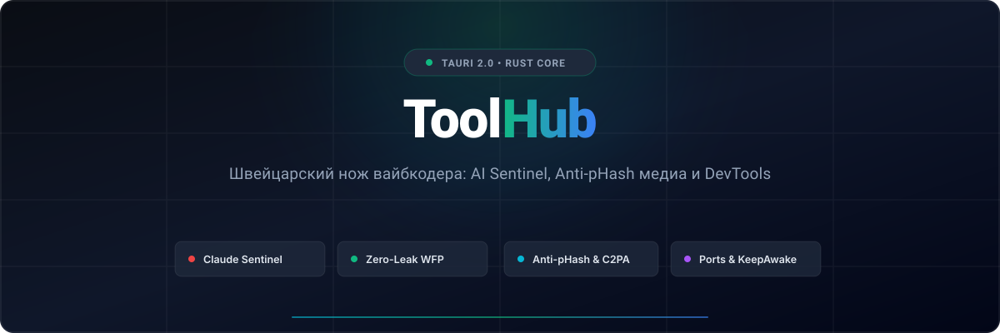
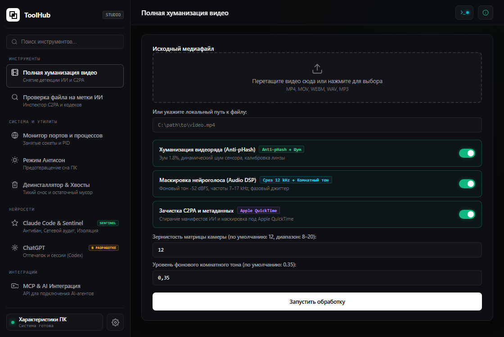
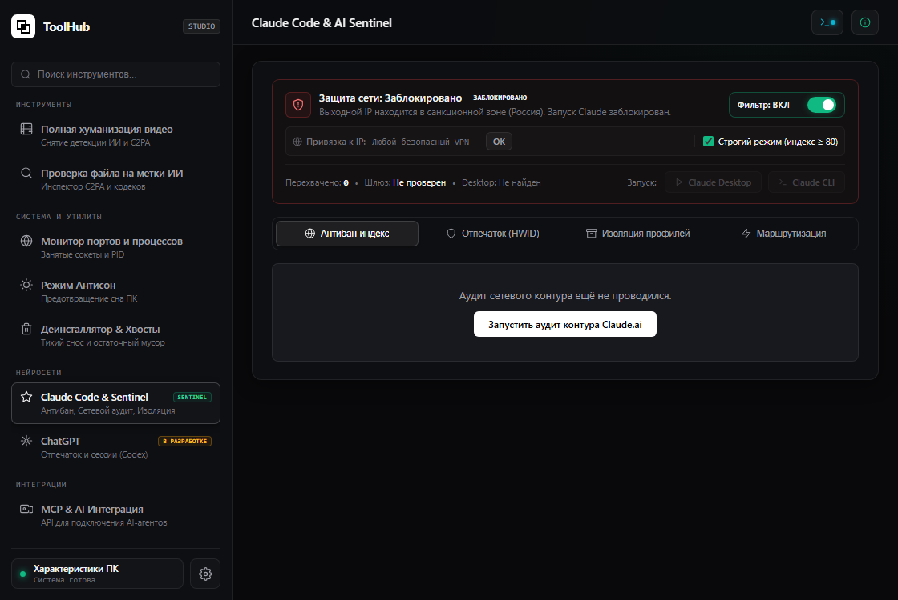

<div align="center">




# ToolHub

**ToolHub** — мощное, быстрое вайбкодерское приложение на базе **Rust**, **Tauri 2.0**

[](LICENSE)
[](https://github.com/wenaro1337/ToolHub/releases)
[](#-сборка-из-исходного-кода)
[](src-tauri)
[](https://tauri.app)

<br>



</div>

---

> [!IMPORTANT]
> **Используйте ToolHub на свой страх и риск.** Некоторые модули меняют настройки Windows, удаляют приложения или обрабатывают файлы. Перед такими операциями сделайте резервную копию важных данных.
> При работе со сторонними сервисами учитывайте их правила и ограничения.

## Основные модули

### 1. Claude Code & AI Sentinel
- **Сетевой риск-аудит**: Проверка Egress IP, Cloudflare edge colo, детекция дата-центров/хостингов, Split-Tunneling и блокированных стран
- **Цифровой отпечаток (machineID Sanitizer)**: Сброс криптографического аппаратного `machineID` (SHA-256) и `userID` в `~/.claude.json` с очисткой очередей телеметрии
- **Изоляция профилей (Config Isolator)**: Создание независимых каталогов профилей `~/.claude-profiles` с генерацией `.bat` / `.sh` файлов запуска, подавлением телеметрии и динамической привязкой `TZ` под проверенный IP
- **Kill-Switch**: Не даст запуститься Claude Code до того как не будет запущен и проверен IP-адрес 

<div align="center">

</div>

### 2. Хуманизация видео (TikTok / Reels / Shorts)
- **Anti-pHash DSP**: Сдвиг перцептивного хэша на 40+ бит за счёт микромасштабирования (1.8%), динамического шума сенсора камеры (PRNU) и микрокоррекции линзы
- **Audio DSP Masking**: Маскировка синтезированных нейроголосов с добавлением естественного комнатного тона и восстановлением спектра выше 12 kHz
- **C2PA & Метаданные**: Полная зачистка от ИИ манифестов и перезапись заголовков контейнера под физическую съёмку Apple QuickTime

### 3. Деинсталлятор & Очистка хвостов (BCU Engine)
- **Молниеносный аудит реестра и UWP**: Опрос `HKLM`/`HKCU` и приложений Windows Store (AppX Bloatware) за миллисекунды
- **Пакетное тихое удаление**: Автоматическое распознавание движков инсталляторов (Inno Setup, MSI, NSIS, Squirrel, Win32) с подстановкой скрытых ключей без лишних диалоговых окон
- **Глубокий поиск и зачистка хвостов**: Анализ и удаление остаточных каталогов в `%AppData%`, `%LocalAppData%`, `%ProgramData%` и ключей реестра с оценкой безопасности

---

## 🛠️ Сборка из исходного кода

### Требования:
- **Rust** 1.78+ (`cargo`)
- **Node.js** 18+ (для сборки UI бандла)
- **Windows 10/11** или **macOS**

### Инструкция:
```bash
# 1. Клонирование репозитория
git clone https://github.com/wenaro1337/ToolHub.git
cd ToolHub

# 2. Сборка монолитного UI (CSS + JS)
node build_ui.js

# 3. Компиляция десктопного release-приложения
cargo build --release --manifest-path src-tauri/Cargo.toml

# Готовый исполняемый файл будет находиться в:
# src-tauri/target/release/toolhub.exe
```

---

## Архитектура автообновлений

ToolHub поддерживает автоматические обновления через **GitHub Releases** и **GitHub Actions**:
1. Релизы собираются и криптографически подписываются через GitHub Actions при пуше тега версии (`v*`)
2. Манифест обновлений `latest.json` раздаётся бесплатно через CDN GitHub Releases
3. Клиент проверяет обновления в приложении и обновляется в 1 клик

---

## Лицензия

MIT
