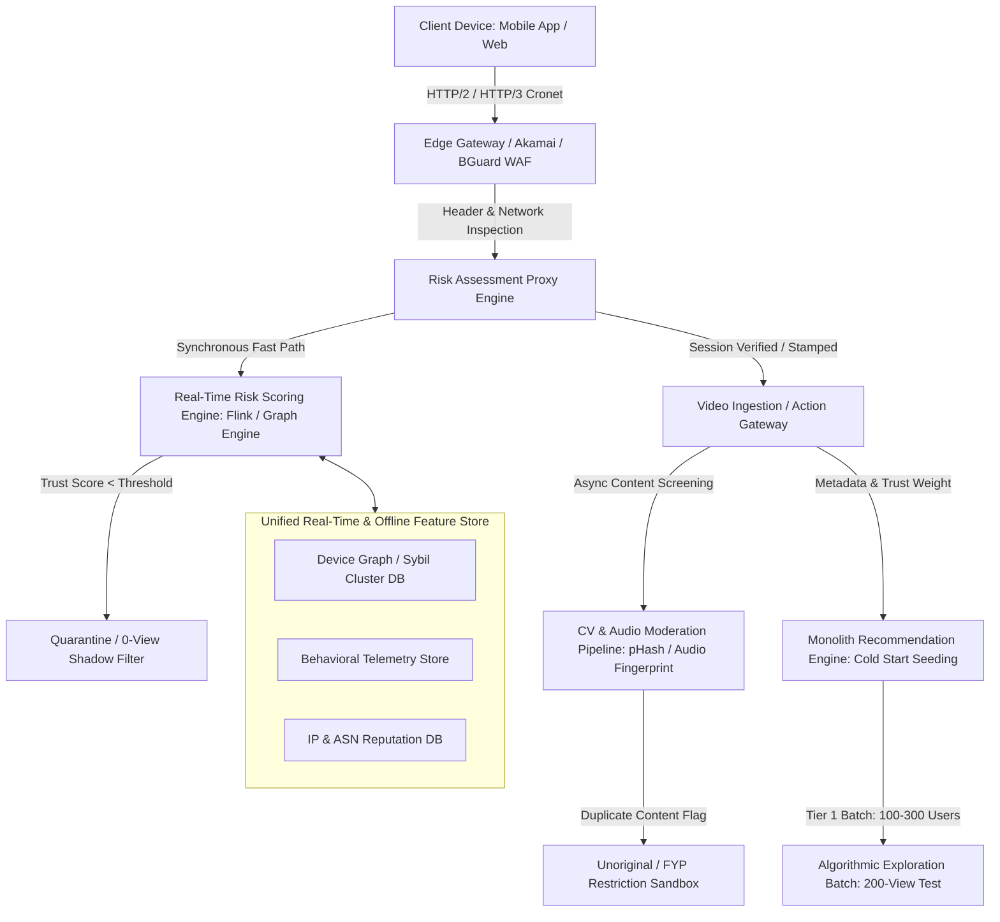
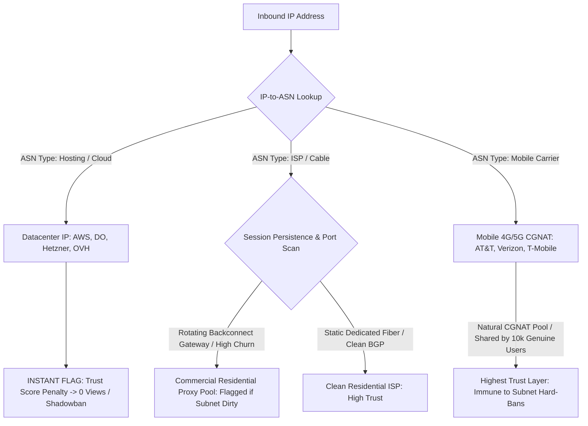
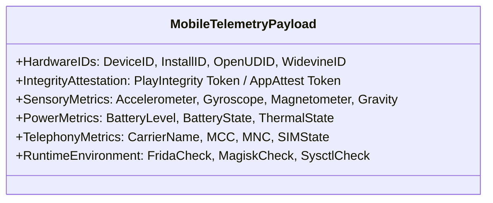
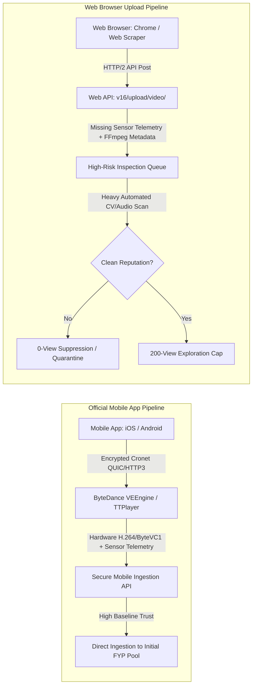
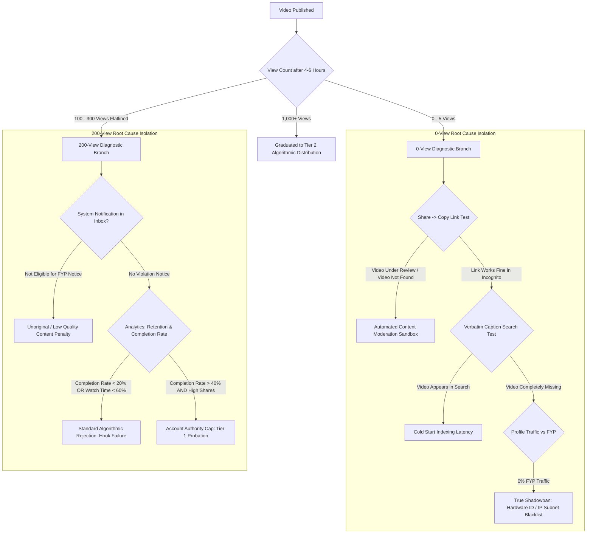

# Deep Technical Analysis: TikTok Trust Score, Anti-Spam Architecture & Forensic Telemetry

**Author:** Subagent 3 — Trust Score & Anti-Spam Analyst  
**Target Architecture:** ByteDance Risk Engine (SecGuard / BGuard / Volcano Engine Anti-Fraud) & Monolith Recommendation Core  
**Scope:** Account Authority Scoring, Network/IP Forensics, Hardware/Browser Telemetry, Web vs Mobile Ingestion Pipelines, and Anomaly Diagnostics.

---

## 1. TikTok Hidden Account Trust Score / Health Score Mechanics

### 1.1 Architectural Overview of the ByteDance Risk Engine
ByteDance operates one of the most sophisticated real-time risk control and anti-abuse distributed engines in the consumer internet industry (historically developed internally as **SecGuard / BGuard** and commercialized partially under **Volcano Engine Risk Control**). The system operates out-of-band and in-line with the primary user traffic path, sitting in front of the **Monolith** recommendation engine.



### 1.2 The Trust Score Vector (Mathematical & Behavioral Components)
Rather than maintaining a single scalar number, ByteDance calculates a dynamic multi-dimensional vector:
$$\mathbf{T} = \left\langle S_{hardware},\, S_{network},\, S_{behavioral},\, S_{graph},\, S_{content} \right\rangle$$

The combined composite score $T_{account} \in [0, 1000]$ dictates the account's operational authority tier:

1. **Hardware & Environment Score ($S_{hardware} \in [0, 250]$):**
   - Cryptographic verification via Google Play Integrity API or Apple App Attest / DeviceCheck.
   - Sensor entropy (accelerometer/gyroscope variance, touch pressure curves, battery decay curves).
   - Kernel and filesystem hygiene (absence of root, jailbreak, Frida hooks, Xposed frameworks, or QEMU/LDPlayer/BlueStacks hypervisor indicators).

2. **Network & Infrastructure Score ($S_{network} \in [0, 200]$):**
   - ASN type (Residential / Mobile Cellular vs. Hosting / Datacenter).
   - TCP/IP stack fingerprint alignment (p0f SYN packet signatures vs. client user-agent claims).
   - IP churn rate, fraud score (IPQS / Scamalytics / MaxMind minFraud), and /24 or /64 subnet cluster saturation.

3. **Behavioral Dynamics & Entropy ($S_{behavioral} \in [0, 250]$):**
   - **Consumption-to-Production Ratio (CPR):** Real humans exhibit a CPR $\ge 20:1$ (watching, liking, pausing, searching before posting). Automated accounts often have a CPR $< 2:1$ (immediate account creation followed by rapid video upload).
   - **Interaction Entropy:** Micro-pauses, irregular scroll velocities, natural viewport dwell times. Uniform dwell times (e.g., exactly 15.00 seconds per video) or robotic touch coordinates (clicking exact Cartesian centers $(x, y)$ of UI buttons with zero pixel jitter) trigger instantaneous automated spam heuristics.

4. **Graph & Association Score ($S_{graph} \in [0, 150]$):**
   - Graph Neural Networks (GNNs) analyzing follower-following topology.
   - Proximity to known Sybil clusters (e.g., accounts created on the same day from identical subnets, using identical profile bios, or following identical seed accounts).

5. **Historical Content & Policy Compliance ($S_{content} \in [0, 150]$):**
   - Historical strike count, automated community guidelines violations, copyright strikes, and DMCA strikes.

---

### 1.3 Account Lifecycle Authority Tiers

| Authority Tier | Internal Designation | Trust Score ($T_{account}$) | Distribution Mechanics & Limits |
| :--- | :--- | :--- | :--- |
| **Tier 0** | **Quarantine / High Risk** | $< 300$ | **Total 0-View suppression.** Videos are ingested, processed, and viewable on profile, but completely excluded from the For You Feed (FYP). Search indexing is revoked. |
| **Tier 1** | **Probation / Cold Start** | $300 - 550$ | **Restricted initial test batch (100–300 views).** Every upload undergoes delayed automated CV/audio screening. Strict retention benchmarks enforced before unlocking Tier 2. |
| **Tier 2** | **Neutral / Established** | $550 - 799$ | **Standard algorithmic distribution.** Immediate indexing into initial seeding batch; standard evaluation gates for viral tier advancement. |
| **Tier 3** | **High Authority / Whitelisted**| $\ge 800$ | **Expedited ingestion.** Bypasses initial probation sandboxes. Initial seeding cohort expands to 1,000–5,000 impressions; higher fault tolerance for false-positive spam flags. |

---

### 1.4 Primary Anti-Bot Flags & Real-Time Triggers
- **Velocity Violations:** Performing $> 15$ follows/unfollows per minute, $> 30$ likes per minute, or uploading $> 3$ videos within a new account's first 24-hour cycle.
- **Immediate Commercial Metadata Mutability:** Registering an account and immediately inserting outbound links in bio, switching to a business account, or mass-messaging DMs prior to establishing baseline organic consumption telemetry.
- **Session Asynchrony / Impossible Travel:** Account sessions authenticated across geographically disjoint IP addresses (e.g., IP in Los Angeles, California and IP in Frankfurt, Germany within 15 minutes) without matching BGP mobile roaming signatures.

---

## 2. Network & IP Forensics: Architecture, Detection & Hygiene

### 2.1 Proxy Type Characterization & Detection Mechanisms



#### A. Datacenter IPs (AWS, DigitalOcean, Hetzner, Linode, OVH, Leaseweb)
- **ASN Classification:** ByteDance utilizes MaxMind GeoIP2 ISP, IPinfo, and proprietary routing table databases. ASNs belonging to hosting providers (e.g., AS16509 Amazon, AS14061 DigitalOcean, AS24940 Hetzner) are strictly identified.
- **Detection:** Zero consumer devices route daily TikTok consumption traffic from hosting ASNs. Ingestion from these IPs is classified as automated scraping, botnet activity, or illicit API abuse, resulting in immediate 0-view sandboxing or HTTP 403 / Captcha challenge triggers.

#### B. Commercial Residential Proxies (Bright Data, Oxylabs, Smartproxy, Webshare)
- **Backconnect Gateways & Churn:** These services route through peer-to-peer networks (often SDK-bundled consumer devices). Packets change public IP endpoints frequently. If an account authenticates one request via an IP in Miami (Comcast) and the next request 30 seconds later via an IP in Chicago (AT&T), the session token encounters an "impossible travel" anomaly.
- **Reputation Pollution:** Residential IPs from pooled providers are frequently reused by automated scrapers, sneaker bots, and credential stuffers, causing elevated fraud scores in commercial threat engines (IPQS score $> 75$, Scamalytics fraud score $> 50$).

#### C. Mobile 4G / 5G Dedicated Proxies (CGNAT)
- **Carrier-Grade NAT (CGNAT):** Mobile network operators (MNOs) assign private IPv4 addresses (RFC 6598: `100.64.0.0/10`) to thousands of mobile phones, translating them to a shared pool of public IPv4 addresses.
- **Architectural Immunity:** TikTok **cannot** outright blacklist a mobile CGNAT public IP without simultaneously blocking thousands of real, paying consumer app users on that cellular tower cluster.
- **Requirements for Legitimacy:** Dedicated SIM dongles (Huawei/ZTE LTE modems or rooted Android devices running proxy daemons), matching local MNO DNS servers, and sticking to single-session IP persistence during active video uploads.

---

### 2.2 Deep Packet Inspection (DPI) & Protocol-Level Leaks

#### 1. Passive OS Fingerprinting (p0f / TCP SYN Signatures)
ByteDance edge servers analyze the initial TCP SYN packet negotiation. Every operating system implements its TCP/IP stack with unique default parameters:

| Metric | Linux / Android | Windows NT | Apple iOS / macOS |
| :--- | :--- | :--- | :--- |
| **Initial TTL** | 64 | 128 | 64 |
| **TCP Window Size** | 29200 / 65535 | 65535 / 8192 | 65535 |
| **TCP Options Order** | `MSS,SACK,TS,NOP,WSCALE` | `MSS,NOP,WSCALE,NOP,NOP,SACK` | `MSS,NOP,WSCALE,NOP,NOP,TS,SACK,EOL` |
| **MTU** | 1500 (Ethernet) | 1500 | 1500 (Ethernet) / 1420 (Cellular) |

**The Red Flag Mismatch:** If an upload originates from a browser whose `User-Agent` claims to be an iPhone on iOS 17 (`TTL = 64`), but the incoming TCP packet reveals `TTL = 128` (Windows standard) or `TCP Options Order` typical of a Linux server, the traffic is flagged as an emulated or proxied spoofing attempt.

#### 2. WebRTC STUN/TURN Candidate Leaking
When using headless browsers or misconfigured proxy wrappers, WebRTC creates asynchronous UDP bindings to ICE/STUN servers (e.g., `stun.l.google.com:19302`). If the browser executes WebRTC calls without a strict UDP proxy bind, the machine's real public WAN IP or local LAN IP (`192.168.x.x` / `10.x.x.x`) is revealed in the SDP (Session Description Protocol) offer, bypassing the HTTP/SOCKS5 proxy tunnel.

#### 3. DNS Resolution Divergence (DNS Leaks)
- If an account operates through an IP geolocated to an ISP in Frankfurt, Germany (Deutsche Telekom), but DNS queries resolve through a public recursive resolver in Virginia, USA (e.g., AWS Route 53 or Google `8.8.8.8` without EDNS Client Subnet preservation), the geo-routing anomaly is logged.
- Mobile devices natively query the carrier’s private DNS servers assigned via DHCP/PPP negotiation.

#### 4. Subnet (/24 and /64) Clustering Flags
ByteDance tracks account density per CIDR block. If 20 accounts are created or active within the same `/24` IPv4 subnet (`198.51.100.0/24`) or `/64` IPv6 prefix, the entire subnet is flagged in the real-time feature store. Any subsequent video uploaded from that CIDR is routed directly into the Tier 0 Quarantine Sandbox.

---

## 3. Device Fingerprinting & Telemetry: Mobile App vs. Web Browser

### 3.1 Mobile Native App Level (ByteDance Security SDK / Applog / SecGuard)

The native mobile app binary (`com.zhiliaoapp.musically` / `com.ss.android.ugc.trill`) embeds ByteDance's proprietary C++ security libraries (`libcms.so`, `libsscronet.so`, and Volcano Engine Device ID SDKs). It harvests comprehensive low-level hardware telemetry:



#### A. Hardware Identifiers & Persistent Storage Tokens
- **Android:**
  - `device_id` and `install_id`: Generated via ByteDance server handshake upon first launch, anchored to hardware variables.
  - `ANDROID_ID` (`Settings.Secure.ANDROID_ID`).
  - Widevine DRM Device Unique Identifier (retrieved via `MediaDrm(WIDEVINE_UUID)`), which survives standard application uninstalls and factory resets.
  - Build fingerprint properties (`ro.build.fingerprint`, `ro.product.model`, `ro.boot.serialno`).
- **iOS:**
  - `identifierForVendor` (IDFV), system boot timestamp (`kern.boottime` via `sysctl`), total physical storage size, hardware model identifier (`sysctl hw.machine` e.g., `iPhone15,2`).
  - Keychain-persisted tokens (persist across app reinstalls).

#### B. Cryptographic Hardware Attestation
- **Google Play Integrity API:** Requests an encrypted, hardware-backed token evaluated against Google servers.
  - `MEETS_BASIC_INTEGRITY`: Verifies basic system hygiene.
  - `MEETS_DEVICE_INTEGRITY`: Verifies the device has an unlocked bootloader, stock certified OEM ROM, and valid hardware keys.
  - `MEETS_STRONG_INTEGRITY`: Hardware-backed Trusted Execution Environment (TEE) / StrongBox verification.
  - *Result:* Emulators (Nox, BlueStacks, LDPlayer) and rooted devices with broken keystores fail `MEETS_DEVICE_INTEGRITY`, resulting in automated device-level blacklisting.
- **Apple App Attest / DeviceCheck:** Uses the Secure Enclave processor to generate an asymmetric key pair signed by Apple's CA, proving that the app binary is unmodified and running on an authentic, non-jailbroken Apple hardware platform.

#### C. Kinematic & Environmental Sensor Telemetry
Legitimate human mobile usage is inherently noisy. ByteDance collects high-frequency sensor readings through `CoreMotion` (iOS) and `SensorManager` (Android):
- **Continuous Tri-Axial Accelerometer & Gyroscope Streams:** Humans holding a phone display constant physiological tremor (frequency: 8–12 Hz) and hold the device at a natural gravitational tilt (pitch: $35^\circ - 65^\circ$).
- **Touch Dynamics:** Capacitive screen touch events record `major_radius`, `minor_radius`, `pressure` (or `force`), and non-linear touch coordinate bezier paths. Emulators send static click events with $0$ radius, $1.0$ synthetic pressure, and perfect linear paths.
- **Battery & Thermal State:** Real devices report variable battery drain curves (e.g., $84\% \to 83\% \to 82\%$), fluctuating temperature, and discharge state. Emulators and cloud devices report constant $100\%$ battery status, `BATTERY_PLUGGED_AC`, and static temperature ($25.0^\circ\text{C}$).
- **Telephony & Carrier Identity:** Querying `TelephonyManager` / `CoreTelephony` for SIM State (`SIM_STATE_READY`), Mobile Country Code (MCC), Mobile Network Code (MNC), and Carrier Name. Devices operating without a physical/eSIM SIM card (WiFi-only) receive lower baseline trust coefficients.

---

### 3.2 Web Browser Level Telemetry (Desktop / Mobile Web Ingestion)

When interacting via `tiktok.com`, TikTok deploys aggressive JavaScript client-side profiling scripts (`bd_ticket_guard.js`, `secsdk.js`, `webmssdk.js`).

#### A. WebGL, Canvas & AudioContext Fingerprinting
- **Canvas Fingerprinting:** Renders hidden 2D primitives, complex Unicode glyphs, and gradients off-screen. Differences in GPU rasterization, driver versions, font smoothing algorithms, and anti-aliasing engines produce a unique hash (CRC32/MD5) of the raw ImageData buffer.
- **WebGL Hardware Extraction:** Queries the `WEBGL_debug_renderer_info` extension:
  - `UNMASKED_VENDOR_WEBGL` (e.g., `Google Inc. (NVIDIA)`)
  - `UNMASKED_RENDERER_WEBGL` (e.g., `ANGLE (NVIDIA, NVIDIA GeForce RTX 3080 Direct3D11 vs_5_0 ps_5_0, D3D11)`).
  - *Bot Red Flag:* Software rasterizers such as `SwiftShader`, `llvmpipe`, or `Mesa OffScreen` trigger immediate headless browser classification.
- **Web Audio API Fingerprinting:** Spawns an `OfflineAudioContext`, routes an oscillator node through a `DynamicsCompressorNode`, and measures the resulting Float32Array frequency buffer. Variations in floating-point processing across CPU microarchitectures yield distinctive signatures.

#### B. Headless Browser & Chrome DevTools Protocol (CDP) Detection
ByteDance runs an array of deterministic checks for automation frameworks (Puppeteer, Playwright, Selenium):
1. **CDP Execution Artifacts:**
   - Detecting `window.navigator.webdriver === true`.
   - Inspection of `Object.getOwnPropertyDescriptor(navigator, 'webdriver')` for prototype tampering.
   - Leakage of `window.chrome.csi`, `window.chrome.loadTimes`, or missing `navigator.plugins` array items.
   - Script execution timing: CDP commands (`Runtime.evaluate`, `Page.addScriptToEvaluateOnNewDocument`) introduce measurable microsecond micro-delays in JavaScript event loop initialization.
2. **Permissions API Inconsistencies:**
   - Querying `navigator.permissions.query({name: 'notifications'})` returning `Prompt`, while `Notification.permission` is set to `Denied` (a classic unpatched Playwright headless discrepancy).
3. **Execution Context Identification:**
   - Scanning for automation utility objects, such as `__puppeteer_evaluation_script__`, `__playwright`, `_selenium`, `callPhantom`, or `cdc_adoQpoasnfa76pfcZLmcfl_` (standard ChromeDriver string token).

---

## 4. Web Upload vs. Official Mobile App Upload: Pipeline Disparities & Safety

### 4.1 Why Web Uploads Trigger Shadowbans, 200-View Caps, or Zero Views



#### 1. Inherent Platform Trust Bias
TikTok is structurally an algorithmically driven mobile-first entertainment network. In their anti-fraud models:
- **Mobile app uploads** are statistically correlated with authentic human creators capturing moments in the physical world.
- **Web uploads** are statistically dominated by mass affiliate marketers, dropshippers, re-upload bot farms, automated content repurposers (clipping streams/podcasts), and spam operations. Consequently, the **default Bayesian prior** for a web upload starts with a high risk penalty.

#### 2. Total Absence of Cryptographic & Kinematic Telemetry
A web upload completely lacks:
- Google Play Integrity / Apple App Attest attestation tokens.
- Native device IDs (`device_id`, `install_id`, Widevine ID).
- Continuous accelerometer, gyroscope, touch force, and ambient sensor telemetry.
Because the ByteDance Risk Engine cannot mathematically verify device authenticity, the video is routed through a secondary defensive pipeline with a strictly capped initial blast radius.

#### 3. Video Codec, Container & Metadata Fingerprinting
When a video is recorded or processed via the TikTok mobile app, the internal media engine (**VEEngine**) injects proprietary EXIF, QuickTime atoms, and encoding parameters:
- **Mobile Camera / In-App Atoms:** Clean H.264/HEVC encoding profiles, native audio container packing, dynamic bitrate allocation matching device hardware capabilities, and specific camera maker atoms (`com.apple.quicktime.make`, `Apple`, `iPhone14,5`).
- **Web / Desktop File Anomalies:** Videos uploaded via the web interface typically originate from desktop NLEs (Adobe Premiere, DaVinci Resolve) or programmatic rendering pipelines (FFmpeg, moviepy).
  - FFmpeg metadata headers: `encoder=Lavf58.76.100`, `Lavc60.3.100`.
  - Missing color matrix tags, non-standard GOP (Group of Pictures) structures, uniform bitrates, and absence of camera sensor optical metadata.
  - ByteDance’s media ingestion pipeline inspects these atoms. An upload with raw FFmpeg signatures from a newly registered account triggers an immediate spam classification flag.

---

### 4.2 Technical Analysis of TikTok Web Upload API

When a user or automated agent uploads via `https://www.tiktok.com/creator-center/upload`, the browser initiates a multi-stage API handshake:

1. **Authentication & Token Initialization:**
   - Endpoints: `https://www.tiktok.com/api/v1/web/project/create/` and `https://www.tiktok.com/passport/web/account/info/`
   - Cookies required: `sessionid`, `ttwid` (ByteDance Web ID tracking cookie), `msToken` (anti-fraud salt token updated asynchronously via WebSocket/Fetch), `tt_chain_token`.
2. **Dynamic Signature Generation (Anti-Replay / Anti-Tamper):**
   - Each HTTP request must include proprietary URL query parameters and headers:
     - `X-Bogus`: A proprietary JavaScript-generated cryptographic signature hashing the request URL, query string, request body, user-agent, and a timestamp.
     - `_signature`: Legacy WebAssembly/JS anti-tamper signature.
     - `X-Argus` / `X-Ladon` / `X-Khronos`: Mobile and advanced web headers containing encrypted environmental data and timestamps.
3. **Video Binary Upload (TOS - ByteDance Object Storage):**
   - Endpoint: `https://v16-upload.tiktok.com/video/tos/...`
   - Upload protocol: Chunked multipart binary upload over HTTP/2, verified by MD5 checksums per chunk.
4. **Publish / Item Creation:**
   - Endpoint: `https://www.tiktok.com/api/v1/item/create/`
   - Payload: Contains video ID, caption text, hashtag tokens, privacy state (`visibility_type`), and client-side rendering metadata.

---

### 4.3 Safe Upload Protocols & Legitimate Emulation

#### Route 1: The Official TikTok Content Posting API (Recommended Enterprise Route)
For automated, scheduled, or third-party web uploads, the only fully sanctioned route that avoids the web-spam risk penalty is the **TikTok Content Posting API v2** (Direct Post / Share to TikTok):
- **Documentation:** `https://developers.tiktok.com/doc/content-posting-api-get-started`
- **Mechanism:**
  - Authenticated via OAuth 2.0 with developer application credentials (`client_key`, `client_secret`) and user authorization scopes (`video.upload`, `video.publish`).
  - Videos are uploaded directly to the creator's account via officially registered webhook and TOS endpoints (`/v2/post/publish/video/init/`).
- **Algorithmic Benefit:** Content uploaded via verified partner API applications (e.g., Buffer, Hootsuite, Later, Sprout Social) is flagged with an official API ingestion origin tag. The ByteDance Risk Engine bypasses headless browser detection and treats the video with standard creator account authority.

#### Route 2: Hardened Browser Ingestion Architecture (For Manual Desktop Workflows)
If uploading via desktop web interfaces, the environment must achieve full cryptographic and environmental consistency:
1. **Anti-Detect Engine:** Use enterprise anti-detect platforms (e.g., AdsPower, Multilogin) utilizing custom Chromium builds that patch CDP leaks at the C++ kernel level (removing `Runtime.enable` artifacts and ensuring native C++ prototype chaining).
2. **Dedicated Mobile 4G/5G Proxy:** Single-tenant mobile SIM dongle with strict session stickiness, matched to the account’s target operating country.
3. **Hardware Acceleration:** Ensure real discrete GPU hardware acceleration is active (`UNMASKED_RENDERER_WEBGL` points to real NVIDIA/AMD/Intel hardware, never virtualized drivers).
4. **Video Strip & Re-Muxing:** Strip telltale FFmpeg encoder tags from video binaries prior to upload:
   ```bash
   ffmpeg -i input.mp4 -map_metadata -1 -c:v copy -c:a copy output_clean.mp4
   ```
5. **Human Interaction Emulation:** Avoid programmatic DOM click execution (`button.click()`). Ensure uploads involve realistic mouse movement trajectories, natural pauses during caption typing, and organic account session maintenance.

---

## 5. Diagnosing Penalties: True Shadowban vs. Cold Start vs. Hardware/IP Flag vs. Unoriginal Content

A creator or system administrator seeing low view counts must isolate the root cause using deterministic telemetry metrics rather than guesswork.



---

### 5.1 Comprehensive Failure Mode Matrix

| Failure State | Primary Symptom | Root Cause | Underlying Technical Mechanism | Actionable Remediation |
| :--- | :--- | :--- | :--- | :--- |
| **Moderation Processing Sandbox** | 0 views for 2–12 hours. | Automated CV / OCR / Audio inspection queue delay. | Machine learning models flagged potential violations (weapons, nudity, text OCR matches banned keywords, medical claims). | Wait 12 hours. Do not delete and re-upload (which resets score and flags velocity abuse). |
| **True Shadowban (Quarantine)** | 0 views indefinitely across all new uploads. Profile views only. | Account Trust Score $T < 300$. Flagged as bot/Sybil account. | ByteDance Risk Engine flagged registration footprint (dirty IP, datacenter ASN, or missing mobile telemetry). | Abandon environment. Must burn account, rotate IP subnet, and reinstall on fresh, non-flagged hardware. |
| **Hardware / Device ID Blacklist** | 0 views on all new accounts created on that specific phone. | Permanent ban on hardware identifiers. | Widevine Device ID, iOS Keychain token, or Android ID recorded in violation database due to past severe bans. | Device cannot be used for TikTok creation. Requires physical device replacement (factory resets do not bypass Widevine ID). |
| **IP / Subnet Blacklist** | 0 views across multiple accounts sharing an IP or subnet block. | Dirty ASN or `/24` subnet cluster quarantine. | IPQS fraud score $> 80$, datacenter hosting ASN, or multiple banned accounts originating from same IP pool. | Rotate to dedicated 4G/5G mobile carrier proxy with clean CGNAT IP. |
| **Unoriginal Content Penalty** | Views flatline at 5–50 views. Explicit system notification received. | Computer Vision Perceptual Hash (pHash) or Audio Match hit. | Video matches existing video in ByteDance's media index (re-uploaded YouTube Short, TikTok clip, or watermark detected). | Appeal via system inbox if original. Otherwise, introduce significant visual/audio transformative alterations. |
| **The 200-View Algorithmic Cap** | Views climb rapidly to 150–250 views, then flatline completely. | Failed the Tier 1 Cold Start Retention Gate. | **NOT A BAN.** The video was shown to 200 real users; audience engagement velocity failed to clear the promotion threshold. | Optimize first 3 seconds (hook), improve completion rate ($> 30\%$), and encourage shares/saves. |

---

### 5.2 The 200-View Cap ("Algorithmic Jail") Deconstructed
The "200-view cap" is the single most misunderstood phenomenon on TikTok. **It is proof that the account is NOT shadowbanned.**

#### The ByteDance Monolith Tier 1 Evaluation Funnel
1. **Initial Seeding:** When a video clears automated safety checks, the Monolith recommendation core injects it into the For You feeds of an initial test cohort of **100 to 300 users** whose interest embeddings match the video’s semantic tags.
2. **Engagement Velocity Metrics:** The algorithm monitors real-time feedback over the first 2 hours:
   $$\text{Score} = w_1(\text{CompletionRate}) + w_2(\text{AvgWatchPercentage}) + w_3(\text{ShareRate}) + w_4(\text{SaveRate}) + w_5(\text{CommentRate})$$
   *(Note: ByteDance weighs **Shares** and **Watch Time / Completion Rate** significantly higher than simple Likes).*
3. **The Threshold Decision Gate:**
   - If **Completion Rate (VTR)** for a 15–30s video is **$< 20 - 25\%$**, or **Average Watch Time** is **$< 60\%$**, the recommendation engine concludes the content lacks audience retention.
   - The engine halts further distribution. The video sits permanently at **200–250 views**.

---

### 5.3 Step-by-Step Triage & Diagnostic Protocol

When an account experiences view stagnation, execute this diagnostic checklist:

#### Step 1: The "Share -> Copy Link" Verification
- Open the stalled video in the TikTok app.
- Tap **Share $\to$ Copy Link**.
- Open a desktop web browser in **Incognito/Private mode** (unauthenticated, no cookies).
- Paste the URL:
  - **Result A:** Video loads and plays normally $\to$ Video is public and indexed.
  - **Result B:** Displays *"Video under review"* $\to$ Video is held in automated content safety quarantine.
  - **Result C:** Displays *"Video unavailable / This video is private"* $\to$ Hard violation or account-level quarantine.

#### Step 2: The Verbatim Search Indexing Test
- Search for the exact video caption enclosed in quotation marks in the TikTok search bar.
- Filter results by **Date Uploaded $\to$ Last 24 Hours**.
  - **Indexed:** Video appears in search $\to$ Account has valid search authority; low views are purely algorithmic/retention-based.
  - **Not Indexed:** Video does not appear $\to$ Account has been suppressed from general indexing (Trust Score penalty or IP flag).

#### Step 3: Analytics Traffic Source Audit
Navigate to **TikTok Studio $\to$ Analytics $\to$ Video Analytics $\to$ Traffic Sources**:
- **Healthy Profile:** **For You Feed: $\ge 70\% - 95\%$**, Personal Profile: $2\% - 10\%$, Search: $2\% - 15\%$.
- **Algorithmic Rejection (200 Views):** **For You Feed: $70\% - 90\%$**, but total view count is $210$. This confirms the video was distributed to the FYP test cohort, but failed retention.
- **True Shadowban / Quarantine:** **For You Feed: $0\%$**, Personal Profile: $90\%+$, Direct Link: $10\%$. Total views $< 10$. This confirms the video was barred from ever entering the FYP recommendation pool.

#### Step 4: The Unoriginal Content Check
Check the account's system notification inbox:
- Look for: *"Not eligible for the For You feed. Content flagged as unoriginal, low-quality, or containing watermarks."*
- ByteDance compares video frames using a combination of **pHash (perceptual hashing)**, **Deep Visual Embeddings (Vision Transformers)**, and audio waveform matching against their global repository of published media.
- If flagged, tap the notification to view the timestamped violation and submit an in-app appeal if the content is verified original.

---

## 6. Summary: Key Takeaways for Systems Engineering & Operations

1. **Account Trust Score is Multidimensional:** ByteDance balances device integrity, network forensics, behavioral entropy, and graph associations. There is no single bypass trick.
2. **Datacenter IPs are Fatal:** Uploading or authenticating from datacenter ASNs (AWS, DigitalOcean, Hetzner) results in immediate Tier 0 quarantine. Dedicated 4G/5G mobile proxies with CGNAT are the standard for network hygiene.
3. **Mobile Telemetry Cannot Be Faked in Standard Browsers:** Native app uploads provide hardware-backed cryptographic proofs (Play Integrity / App Attest) and rich sensor noise that web browsers fundamentally cannot supply.
4. **Web Uploads Require Sanctioned APIs:** Automated workflows must utilize the official TikTok Content Posting API v2 to preserve account trust and ensure full FYP recommendation distribution.
5. **Differentiate 0 Views from 200 Views:** 0 views is a technical, network, or policy block; 200 views is normal algorithmic exploration that stalled due to low viewer retention.
